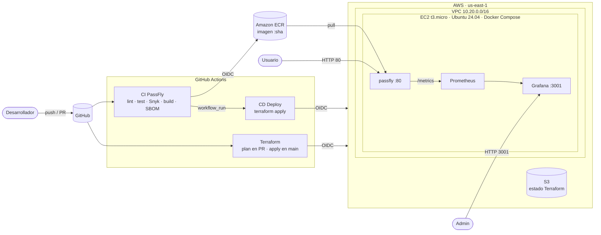

# PassFly ✈️ — CI/CD con GitHub Actions, Terraform y Docker en AWS

[](https://github.com/mssalazarb/mundos-e-proyecto-integrador-1/actions/workflows/ci-passfly.yml)
[](https://github.com/mssalazarb/mundos-e-proyecto-integrador-1/actions/workflows/cd-deploy.yml)
[](https://github.com/mssalazarb/mundos-e-proyecto-integrador-1/actions/workflows/terraform.yml)

**Proyecto Integrador Final (PIN) · Proyecto 1: _CI/CD con GitHub Actions + Terraform + Docker_**
Diplomatura DevOps · mundosE / UNC FCEFyN

PassFly es un generador de contraseñas seguras y aleatorias (sin login, sin base de datos) usado como aplicación base para construir y demostrar un flujo DevOps completo: **integración continua, entrega continua, infraestructura como código, contenedores, seguridad y observabilidad**, con todo el ciclo de vida gestionado desde GitHub.

---

## Contenido

1. [Objetivo y alcance](#1-objetivo-y-alcance)
2. [Arquitectura](#2-arquitectura)
3. [Cumplimiento de la rúbrica](#3-cumplimiento-de-la-rúbrica)
4. [Pipelines](#4-pipelines)
5. [La aplicación](#5-la-aplicación)
6. [Infraestructura como código](#6-infraestructura-como-código)
7. [Contenedor](#7-contenedor)
8. [Seguridad](#8-seguridad)
9. [Observabilidad](#9-observabilidad)
10. [Puesta en marcha](#10-puesta-en-marcha)
11. [Desarrollo local](#11-desarrollo-local)
12. [Evidencias](#12-evidencias)
13. [Costos, limitaciones y mejoras](#13-costos-limitaciones-y-mejoras)
14. [Estructura del repositorio](#14-estructura-del-repositorio)

---

## 1. Objetivo y alcance

Construir un pipeline en **GitHub Actions** que compile, pruebe y despliegue una aplicación generada con IA en un **contenedor Docker**, con la infraestructura gestionada con **Terraform** en **AWS**, controles de seguridad en el pipeline y monitoreo con **Prometheus y Grafana**.

| Categoría | Herramienta elegida |
|---|---|
| CI/CD | GitHub Actions |
| IaC | Terraform |
| Contenedores | Docker (imágenes en Amazon ECR) |
| Seguridad | ESLint + Snyk (+ `npm audit` y SBOM) |
| Monitoreo | Prometheus + Grafana |
| Nube | AWS (EC2, VPC, ECR, S3, IAM) |

**Decisiones clave**
- **Monorepo** con dos directorios independientes (`passfly/` y `terraform/`) y pipelines que solo se activan cuando cambia su parte.
- **Todo nace en GitHub**: incluso el bucket del estado de Terraform, el registro de imágenes y los roles IAM se crean con un workflow (*Bootstrap*).
- **Sin claves de AWS permanentes** en los pipelines: autenticación con **OIDC** y credenciales temporales.

## 2. Arquitectura



**Flujo en una frase:** un cambio en `passfly/` pasa por CI, se publica como imagen inmutable en ECR y CD la despliega con Terraform en una EC2 que ejecuta la app junto a Prometheus y Grafana.

## 3. Cumplimiento de la rúbrica

Correspondencia entre lo que pide el Proyecto 1 del PIN y lo implementado.

### Entregables

| Entregable solicitado | Dónde está |
|---|---|
| Workflow `.yml` en GitHub Actions | [`.github/workflows/`](.github/workflows/) |
| Archivos Terraform (`.tf`) para levantar la infraestructura | [`terraform/`](terraform/) |
| `Dockerfile` y artefacto generado | [`passfly/Dockerfile`](passfly/Dockerfile) · imagen `passfly:<sha>` en ECR |
| SBOM (CycloneDX/SPDX) | Artefacto `sbom` de cada ejecución de CI: `sbom.cdx.json` (CycloneDX) y `sbom-image.spdx.json` (SPDX) |
| Captura del dashboard de métricas básicas | [`docs/evidencias/`](docs/evidencias/) · dashboard en [`terraform/monitoring/`](terraform/monitoring/grafana/dashboards/passfly.json) |

### Criterios de evaluación

| Criterio | Peso | Qué se implementó |
|---|---|---|
| **Pipeline CI/CD** | 25% | CI con `lint → test → seguridad → build → push a ECR`; CD con `terraform plan/apply`; pipeline de infraestructura independiente. Ver [§4](#4-pipelines) |
| **Infraestructura** | 20% | Terraform crea VPC, subred, security group, rol IAM, EC2 e IP elástica, con estado remoto en S3 y bloqueo. Ver [§6](#6-infraestructura-como-código) |
| **Contenedor** | 15% | Dockerfile multi-stage, usuario no root, `HEALTHCHECK`, dependencias fijadas con `package-lock.json` (`npm ci`). Ver [§7](#7-contenedor) |
| **Seguridad** | 20% | ESLint, Snyk, `npm audit`, SBOM (CycloneDX y SPDX), escaneo de ECR al subir, OIDC, mínimo privilegio. Ver [§8](#8-seguridad) |
| **Observabilidad** | 10% | Métricas propias en `/metrics`, Prometheus y dashboard de Grafana aprovisionado por código. Ver [§9](#9-observabilidad) |
| **Documentación** | 10% | Este README, [`terraform/README.md`](terraform/README.md), [`passfly/README.md`](passfly/README.md) y [evidencias](#12-evidencias) |

## 4. Pipelines

Cinco workflows en [`.github/workflows/`](.github/workflows/):

| Workflow | Archivo | Se activa con | Función |
|---|---|---|---|
| **Bootstrap** | `bootstrap.yml` | Manual (una vez) | Crea el bucket S3 del estado, el repositorio ECR, el proveedor OIDC y los roles IAM. Es el único que usa claves estáticas |
| **CI PassFly** | `ci-passfly.yml` | PR o push que toque `passfly/**`; manual | Valida, prueba, escanea, construye y publica la imagen |
| **CD Deploy** | `cd-deploy.yml` | CI exitoso en `main`; manual | Despliega todo: aplica Terraform con la imagen recién publicada. Permite `destroy` |
| **Terraform** | `terraform.yml` | PR o push que toque `terraform/**` | PR: `fmt` + `validate` + **plan** (solo lectura). `main`: **apply** reutilizando la imagen desplegada |
| *(reutilizable)* | `_terraform-apply.yml` | Lo llaman CD Deploy y Terraform | `init` → `fmt` → `validate` → `plan` → `apply` serializado |

### CI PassFly

```
lint ─┐
test ─┼─▶ build ──▶ (solo en main) push a ECR
sec  ─┘
```

| Job | Pasos |
|---|---|
| `lint` | `npm ci` → **ESLint** |
| `test` | `npm ci` → **20 tests** (`node:test` + supertest): generador, API, cabeceras de seguridad, métricas, rate limit |
| `security` | `npm audit` (dependencias de producción, nivel alto) → **Snyk** `test` → Snyk `monitor` (registra el proyecto en app.snyk.io) |
| `build` | **SBOM CycloneDX** → build Docker local → **SBOM SPDX** de la imagen → push a ECR con tag `<sha>` (solo en `main`) |

La imagen **solo se publica si todos los jobs anteriores pasan**, y se construye y analiza antes de subirse.

### CD Deploy y Terraform

```
cambio en passfly/    ──▶ CI PassFly ──▶ ECR ──▶ CD Deploy ──▶ terraform apply (tag nuevo)
cambio en terraform/  ──▶ Terraform  ──▶ PR: plan │ main: terraform apply (tag actual)
```

- Los despliegues se **serializan** (`concurrency`): nunca hay dos `apply` sobre el mismo estado.
- El despliegue usa el *environment* `production` (admite revisores obligatorios).
- `terraform.yml` reutiliza el tag ya desplegado, leído del estado, por lo que cambiar infraestructura no obliga a reconstruir la imagen.

## 5. La aplicación

Monolito **Node.js 22 + Express** que sirve la interfaz web y la API. Sin autenticación ni base de datos: las contraseñas **no se almacenan ni se registran**.

- **Parámetros**: longitud (8–128), minúsculas, mayúsculas, números, símbolos, excluir caracteres ambiguos (`O 0 I l 1 |`) y cantidad (1–10).
- **Generación**: `crypto.randomInt` (aleatoriedad criptográfica) + mezcla Fisher-Yates; garantiza al menos un carácter de cada tipo seleccionado.
- **Frontend**: HTML, CSS y JavaScript sin dependencias ni paso de build; indicador de fortaleza (entropía en bits) y botón de copiar.

| Endpoint | Descripción |
|---|---|
| `POST /api/v1/passwords` | Genera contraseñas. Cuerpo JSON con los parámetros |
| `GET /health` | Healthcheck |
| `GET /metrics` | Métricas de Prometheus |
| `GET /` | Interfaz web |

```bash
curl -s http://<ip>/api/v1/passwords -H 'Content-Type: application/json' \
  -d '{"length":24,"symbols":false}'
# {"passwords":["..."],"entropyBits":143,"strength":"muy fuerte"}
```

Más detalle en [`passfly/README.md`](passfly/README.md).

## 6. Infraestructura como código

Dos módulos Terraform (≥ 1.10, estado remoto en S3 con bloqueo nativo `use_lockfile`):

| Módulo | Recursos | Quién lo aplica |
|---|---|---|
| [`terraform/bootstrap`](terraform/bootstrap) | Bucket S3 de estado (versionado, cifrado, sin acceso público) · repositorio **ECR** (tags inmutables, escaneo al subir, política de retención) · proveedor **OIDC** de GitHub · roles `passfly-github-ci`, `-plan` y `-cd` | Workflow **Bootstrap** |
| [`terraform/main`](terraform/main) | **VPC** y subred pública · **security group** · rol e instance profile · **EC2** `t3.micro` Ubuntu 24.04 · **IP elástica** | Workflows **CD Deploy** y **Terraform** |

En la instancia, `cloud-init` instala Docker y levanta con Docker Compose tres contenedores: `passfly` (puerto 80), `prometheus` (solo `localhost`) y `grafana` (puerto 3001). Los archivos de monitoreo se incluyen en el `user_data` desde [`terraform/monitoring/`](terraform/monitoring/).

## 7. Contenedor

[`passfly/Dockerfile`](passfly/Dockerfile):

- **Multi-stage**: una etapa instala solo dependencias de producción (`npm ci --omit=dev`) y la imagen final copia únicamente lo necesario, sobre `node:22-alpine`.
- **Reproducible**: `package-lock.json` fijo y `npm ci`.
- **Usuario no root** (`USER node`).
- **`HEALTHCHECK`** sobre `/health`.
- Etiquetas OCI (`org.opencontainers.image.source` y `revision`) añadidas en CI.
- Tag de imagen = **SHA del commit**, inmutable en ECR: cada despliegue es trazable a un commit.

## 8. Seguridad

| Capa | Control |
|---|---|
| **Código** | ESLint en cada PR y push |
| **Dependencias** | `npm audit` (falla en nivel alto) y **Snyk** (`--severity-threshold=high`) con registro del proyecto en Snyk |
| **Cadena de suministro** | **SBOM** CycloneDX (dependencias) y SPDX (imagen) como artefactos de cada ejecución |
| **Imágenes** | ECR con tags inmutables y escaneo al subir; contenedor sin root |
| **Aplicación** | `helmet` (CSP, cabeceras), rate limiting (60 peticiones/min por IP), validación estricta de entradas, `Cache-Control: no-store`, errores sin *stack traces*, contraseñas nunca registradas ni expuestas en métricas |
| **Acceso a AWS** | **OIDC**: sin claves permanentes en los pipelines; credenciales temporales por ejecución |
| **Mínimo privilegio** | Tres roles con confianza acotada: **CI** (solo sube a ECR, solo rama `main`), **PLAN** (solo lectura, solo pull requests) y **CD** (despliega, solo desde el environment `production`) |
| **Infraestructura** | Sin SSH (acceso por SSM), IMDSv2 obligatorio, disco cifrado, Prometheus no expuesto, Grafana restringible por CIDR (`ADMIN_CIDR`), estado de Terraform cifrado y versionado |

## 9. Observabilidad

- La app expone en `/metrics`: `passfly_passwords_generated_total`, `passfly_http_request_duration_seconds` y las métricas estándar del proceso Node.js. Nunca incluyen contraseñas.
- **Prometheus** recoge las métricas cada 15 s ([`prometheus.yml`](terraform/monitoring/prometheus.yml)).
- **Grafana** carga el *datasource* y el dashboard **PassFly - Overview** por aprovisionamiento ([`passfly.json`](terraform/monitoring/grafana/dashboards/passfly.json)), sin configuración manual:

| Panel | Métrica |
|---|---|
| Contraseñas generadas (total) | `sum(passfly_passwords_generated_total)` |
| Latencia p95 | `histogram_quantile(0.95, …)` |
| Servicio activo | `up{job="passfly"}` |
| Errores 5xx (5 min) | peticiones con estado `5xx` |
| Contraseñas por minuto | `rate(passfly_passwords_generated_total[1m])` |
| Peticiones por segundo según código | agrupadas por `status` |
| Memoria residente y CPU | métricas del proceso |

## 10. Puesta en marcha

Todo se ejecuta desde GitHub; nada corre en la máquina local. Guía completa y detallada en [`terraform/README.md`](terraform/README.md).

1. **Crear el repositorio** y subir el código a la rama `main`.
2. **Configurar GitHub** (*Settings → Secrets and variables → Actions*):

   | Tipo | Nombre | Uso |
   |---|---|---|
   | Secreto | `AWS_ACCESS_KEY_ID`, `AWS_SECRET_ACCESS_KEY` | Solo para Bootstrap; se pueden borrar después |
   | Secreto | `SNYK_TOKEN` | Análisis de dependencias con Snyk |
   | Variable | `AWS_ACCOUNT_ID`, `AWS_REGION` | Cuenta y región de AWS |
   | Variable (recomendada) | `ADMIN_CIDR` | Tu IP en formato `x.x.x.x/32`, para restringir Grafana |

3. **Ejecutar *Bootstrap*** (Actions → Bootstrap → *Run workflow*). Crea S3, ECR, OIDC y roles, y lanza CI.
4. **CI publica la primera imagen y CD Deploy despliega.** Las URLs aparecen en el resumen del job.
5. **Operación diaria**: cada cambio en `passfly/` o `terraform/` dispara el pipeline correspondiente.
6. **Destruir** al terminar: Actions → *CD Deploy* → *Run workflow* → acción `destroy`.

## 11. Desarrollo local

```bash
# Aplicación
cd passfly
npm ci
npm start          # http://localhost:3000
npm test           # 20 tests
npm run lint
npm run sbom       # SBOM CycloneDX

# Stack completo con monitoreo (desde la raíz)
docker compose up --build   # app :3000 · Prometheus :9090 · Grafana :3001 (admin/admin)
```

## 12. Evidencias

Carpeta [`docs/evidencias/`](docs/evidencias/). Capturas y/o video para la presentación:

- [ ] Ejecución de **CI PassFly** en verde (lint, test, security, build)
- [ ] Paso **Snyk** ejecutado y proyecto registrado en app.snyk.io
- [ ] Imagen publicada en **ECR** (tag = SHA del commit)
- [ ] Ejecución de **CD Deploy** con `terraform apply` y resumen de URLs
- [ ] Recursos creados en **AWS** (EC2, VPC, S3, ECR)
- [ ] **PassFly** funcionando en el navegador
- [ ] Dashboard **PassFly - Overview** de Grafana con datos
- [ ] **SBOM** descargado (`sbom.cdx.json` y `sbom-image.spdx.json`)
- [ ] *(Opcional)* Video corto de 2 a 3 minutos: `push` → pipeline → despliegue → dashboard

## 13. Costos, limitaciones y mejoras

**Costos aproximados:** una `t3.micro`, 20 GB de disco gp3 y una IP elástica asociada. **Destruir el stack al terminar la demo.**

**Limitaciones conocidas**
- La app se sirve por **HTTP**. En producción convendría HTTPS (certificado + balanceador o CloudFront) y activar `HTTPS_ONLY=true`.
- Cada despliegue **reemplaza la instancia** (hay unos minutos de indisponibilidad; la IP elástica se conserva).
- Grafana queda abierto a internet si no se define `ADMIN_CIDR`; solo lo protege su contraseña.
- El rol de CD usa `ec2:*`: amplio a propósito para simplificar; en producción conviene acotarlo.
- Una sola instancia, sin alta disponibilidad ni *autoscaling*.

**Posibles mejoras:** firma de imágenes con cosign y repositorio de artefactos (Proyecto 3), SonarQube, HTTPS, despliegue sin interrupción (ECS/Fargate o balanceador), alertas en Prometheus/Alertmanager.

## 14. Estructura del repositorio

```
.
├── passfly/                    # Aplicación (Node.js + Express + frontend)
│   ├── src/  public/  test/
│   ├── Dockerfile
│   └── package.json
├── terraform/
│   ├── bootstrap/              # S3 de estado, ECR, OIDC y roles IAM
│   ├── main/                   # VPC + EC2 + Docker Compose
│   └── monitoring/             # Prometheus y dashboard de Grafana
├── docs/evidencias/            # Capturas y evidencias para la entrega
├── docker-compose.yml          # Stack local: app + Prometheus + Grafana
└── .github/workflows/
    ├── bootstrap.yml
    ├── ci-passfly.yml
    ├── cd-deploy.yml
    ├── terraform.yml
    └── _terraform-apply.yml
```
